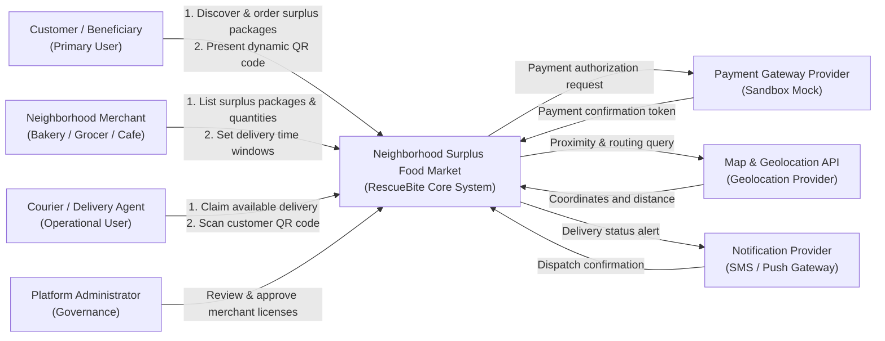
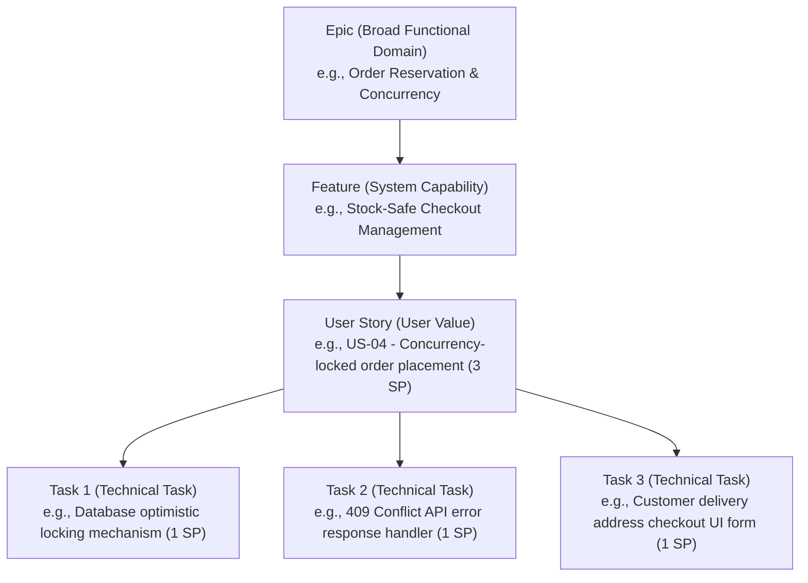

# SENG 321 Software Engineering Project
# Sprint 1 Report: Project Foundation & Team Operating Model

**Project Name:** Neighborhood Surplus Food Market (RescueBite)  
**Domain:** Food Waste Prevention & Doorstep Courier Delivery Platform  
**Team Number:** [Team 13]  
**Academic Term:** 2025-2026 Academic Year | Sprint 1  
**Sprint Weight:** 15% of Overall Course Grade  

---

## 1. Project Proposal

### 1.1 Problem Statement and Supporting Evidence
In urban centers and local neighborhoods, bakeries, grocery stores, cafes, and restaurants discard significant quantities of wholesome, edible food every evening simply because it remained unsold before closing time.
* **Global and National Evidence:** According to the United Nations Environment Programme (UNEP) Food Waste Index Report, over 1 billion tonnes of food is wasted globally each year. In Turkey, per capita household and retail food waste exceeds 93 kg annually.
* **Impact on Local Merchants:** Neighborhood merchants (small-scale bakeries, patisseries, boutique grocers) face direct revenue losses and inventory write-offs daily. Implementing traditional discount racks damages brand perception and creates administrative overhead.
* **Impact on Consumers in Need:** In an inflationary food market, university students, low-income households, and budget-conscious residents struggle to access nutritious, high-quality food at affordable prices. Furthermore, physically asking merchants for leftover food right before closing creates social friction and stigma.
* **Measurable Baseline Problem:** Tons of fresh food perish daily at neighborhood scales, generating preventable municipal waste, high disposal costs, and avoidable carbon emissions.

### 1.2 Stakeholder Identification and Analysis

| Stakeholder | Role & Classification | System Expectations & Needs | Impact & Dependency |
|---|---|---|---|
| **Customer (Consumer / Beneficiary)** | Primary User | Search and filter discounted surplus food packages nearby, order with doorstep delivery, and confirm handover via dynamic QR code. | High Impact, High Dependency |
| **Store (Merchant: Bakery, Grocer, Cafe)** | Operational User | Quickly list end-of-day surplus inventory, configure quantity limits, set delivery time windows, and hand over packages to couriers. | High Impact, High Dependency |
| **Platform Administrator (Admin)** | Governance & Compliance | Review merchant registrations, verify food hygiene compliance (`Store Approval`), and monitor platform metrics. | High Impact, High Dependency |
| **Courier (Delivery Agent)** | Operational Field User | View available ready packages, claim delivery assignments, navigate to the customer, and scan the QR code to verify handover. | Medium Impact, High Dependency |
| **Map & Geolocation Provider** | External System Dependency | Provide merchant geocoding, proximity search radius, and courier navigation routing. | High Dependency |
| **Payment Gateway Provider** | External System Dependency | Secure card payment tokenization, authorization, and merchant escrow settlements. | High Dependency |
| **Notification Service Provider** | External System Dependency | Deliver SMS and push alerts (e.g., "Courier assigned", "Package delivered"). | Medium Dependency |

### 1.3 Proposed Solution and Expected Outcomes
**Neighborhood Surplus Food Market (RescueBite)** is a social-impact digital platform connecting neighborhood merchants with consumers. Merchants package surplus, fresh end-of-day food into discounted surplus batches (at least 50%–70% off regular prices). Customers purchase these packages through the web/mobile app, and neighborhood couriers pick up and deliver them directly to their doorstep with QR code verification.

* **Core Strengths:**
  1. **Social Impact Narrative:** Diverts nutritious food from municipal landfills and makes it accessible to students and low-income community members.
  2. **Measurable Outcomes:** Tracks kilograms of food rescued, number of surplus bags saved, and equivalent greenhouse gas emissions prevented.
* **Measurable Baseline Success Targets:**
  1. An eligible customer completes a surplus food package order in **less than 2 minutes**.
  2. A verified merchant lists an end-of-day surplus inventory batch in **under 90 seconds**.
  3. The initial neighborhood pilot diverts at least **600 kg of fresh food waste** in its first operating month.
  4. Concurrent checkouts for limited items eliminate double-booking entirely by returning **HTTP 409 Conflict** on depleted inventory.

### 1.4 Feasibility Assessment and Initial Scope

* **Technical Feasibility:** Modern RESTful architecture, API-first development, OpenAPI 3.1.0 specifications, and sandbox stub services allow full delivery within the 14-week academic semester.
* **Operational Feasibility:** Merchants do not require complex POS integrations; they simply select standard package categories, set available quantities, and specify delivery hours. Handover is cryptographically verified via a dynamic QR code.
* **Legal and Ethical Compliance:** Food hygiene compliance and merchant certifications are verified during onboarding. Terms of service explicitly state allergen disclaimers and consumer food handling instructions.
* **First Release Scope:**
  * **In-Scope:**
    * Administrator store verification workflow (`updateStoreApproval`).
    * Approved merchants creating end-of-day surplus packages (regular price, discounted price, stock quantity, delivery window, estimated weight).
    * Customer surplus package discovery, cart checkout, and doorstep delivery ordering (returns **409 Conflict** on stock depletion).
    * Courier delivery pool, atomic assignment claim (returns **409 Conflict** on race condition), and dynamic QR verification (`verifyDeliveryQR`).
    * Cumulative food waste saved metrics counter (in kg).
  * **Deferred / Out-of-Scope:**
    * Inter-city or cold-chain logistics (scope is strictly neighborhood doorstep delivery).
    * Real-time GPS street-by-street map rendering animations (static coordinates and milestone statuses used in release 1).
    * Real-time automated ERP inventory sync with retail cash registers.

### 1.5 Assumptions, Potential Risks, and Validation Actions

| Type | Statement | Validation or Response Strategy |
|---|---|---|
| **Assumption** | Local bakeries, cafes, and grocers are willing to sell remaining surplus at deep discounts rather than discarding it. | Conduct face-to-face discovery interviews and obtain letters of intent from 5 local merchants. |
| **Risk (Inventory Concurrency)** | Two customers submit checkout requests simultaneously for the last remaining surplus package unit. | Enforce database-level optimistic/pessimistic locking and return **HTTP 409 Conflict (PACKAGE_SOLD_OUT)**. |
| **Risk (Courier Claim Race)** | Two couriers attempt to claim the same delivery order simultaneously. | Implement atomic status transitions; the second courier receives **HTTP 409 Conflict (DELIVERY_ALREADY_CLAIMED)**. |
| **Risk (Delivery Time Window Expiry)** | Customer is unreachable or delivery is attempted outside the agreed operating hours. | Require dynamic QR verification; reject expired or invalid tokens with **HTTP 409 Conflict (INVALID_QR_VERIFICATION)**. |
| **Risk (External Dependencies)** | Third-party payment or map APIs impose rate limits or costs during development. | Implement documented local sandbox stubs matching the production API boundaries. |

### 1.6 Open-Source License Decision Record

```markdown
Decision: Apache License 2.0

Rationale:
- Allows permissive use, modification, and redistribution for academic and commercial evaluation.
- Includes an explicit patent grant, providing greater protection than MIT.
- Matches modern industry standards and provides seamless compatibility with third-party dependencies.

Follow-up:
- Placed complete license text as LICENSE in the repository root.
- Add copyright headers to source files.
- Inspect direct and transitive dependency licenses in each sprint.
```

---

## 2. System Vision and Boundary

### 2.1 Project Purpose and Target Users (System Vision)
> **System Vision Statement:**  
> *"For neighborhood merchants who seek to prevent end-of-day food waste and budget-conscious community members who need affordable, quality meals, the **Neighborhood Surplus Food Market (RescueBite)** provides an integrated surplus food catalog, concurrent stock protection, courier delivery dispatch, and dynamic QR proof-of-delivery. Unlike traditional food delivery networks, it eliminates food waste, offers real-time impact metrics, and prevents handover fraud without burdensome infrastructure."*

### 2.2 System Boundary and Context Diagram



### 2.3 System Responsibilities (Inside vs. Outside Boundaries)

| Inside Software Responsibility | Outside Boundary / Deferred |
|---|---|
| Surplus food package catalog and real-time inventory tracking | Payment processing banking clearinghouse |
| Concurrency conflict resolution and stock locking (HTTP 409) | Physical courier vehicle fleet maintenance |
| Delivery time window validation and expiration handling | Street-by-street map rendering engine (External Map API) |
| Dynamic QR token generation and doorstep verification | SMS/Push telecommunication gateway infrastructure |
| Administrator merchant approval workflow (`isApproved: true/false`) | Merchant physical kitchen operations and hygiene compliance |
| Environmental metrics tracking (cumulative kg food saved) | Merchant official taxation and corporate accounting ERP sync |

---

## 3. OpenAPI Draft Summary

The system is designed following strict API-first principles and is formally defined in [`api/openapi.yaml`](../../api/openapi.yaml) conforming to the **OpenAPI 3.1.0** standard.

### 3.1 API Resources and HTTP Operations

| Path | HTTP Method | Operation ID | Role / Security | Description & Status Codes |
|---|---|---|---|---|
| `/packages` | `GET` | `listAvailablePackages` | Public | Lists active surplus food packages filtered by location and category (`200 OK`, `400`). |
| `/packages` | `POST` | `createPackage` | Approved Merchant | Lists a new end-of-day surplus inventory batch. If unapproved, returns **`403 Forbidden (STORE_NOT_APPROVED)`** (`201 Created`). |
| `/packages/{packageId}` | `GET` | `getPackageById` | Public | Returns detailed package contents and delivery window (`200 OK`, `404`). |
| `/orders` | `POST` | `createOrder` | Customer (BearerAuth) | Purchases package with doorstep delivery. **If stock is exhausted, returns `409 Conflict (PACKAGE_SOLD_OUT)`** (`201 Created`). |
| `/orders/{orderId}` | `GET` | `getOrderById` | Customer / Store | Returns order status, assigned courier, and pickup verification QR token (`200 OK`, `404`). |
| `/deliveries/available` | `GET` | `listAvailableDeliveries` | Courier (BearerAuth) | Lists orders ready at stores awaiting courier pickup (`200 OK`). |
| `/deliveries/{orderId}/claim` | `POST` | `claimDelivery` | Courier (BearerAuth) | Courier claims order. **If already taken, returns `409 Conflict (DELIVERY_ALREADY_CLAIMED)`** (`200 OK`). |
| `/deliveries/{orderId}/verify-qr` | `POST` | `verifyDeliveryQR` | Courier (BearerAuth) | Courier scans customer dynamic QR code. On match, updates to `DELIVERED`. **If invalid or expired, returns `409 Conflict`** (`200 OK`). |
| `/admin/stores/{id}/approve` | `PATCH` | `updateStoreApproval` | Platform Admin | Updates merchant hygiene and license approval status (`200 OK`, `403`). |

### 3.2 Error Handling Standard (RFC 7807 / RFC 9457 `ProblemDetails`)
All domain failures are modeled with standard machine-readable problem details:
```json
{
  "title": "Package Sold Out",
  "status": 409,
  "code": "PACKAGE_SOLD_OUT",
  "detail": "The selected surplus package is sold out or the last unit was claimed by another customer."
}
```

---

## 4. Team Roles and RACI Matrix

In strict compliance with the **BM321 Software Engineering Team Project Specification and Rubric (v2)**, team responsibilities and required outputs are explicitly mapped to the official rubric role definitions:

### 4.1 Team Roles and Required Outputs (Official BM321 Rubric Table)

| Role Title | Primary Responsibility | Required Outputs and Tasks (BM321 Specification) | Assigned Member |
|---|---|---|:---:|
| **Product Owner and Requirements Engineer** | Requirements engineering and product vision | User stories, acceptance criteria, product backlog, prioritization, and stakeholder validation. | **Member 1** |
| **Scrum Master and Agile Process Coach** | Agile process management and communication | Stand-up and retrospective records, RACI matrix, impediment tracking, and GitHub Projects or Jira board administration. | **Member 3** |
| **Lead Software Architect and Technical Lead** | System and software architecture | C4 model, UML diagrams, architecture strategy, API-first or microservices decisions, and code review leadership. | **Member 2** |
| **Quality Assurance and Test Automation Engineer** | Quality assurance and test automation | Unit, integration, and end-to-end tests, test plans, defect tracking, and at least 50 percent unit-test coverage monitoring. | **Member 4** |
| **DevOps and CI CD Infrastructure Engineer** | Infrastructure, configuration, and deployment | GitHub Actions continuous integration and continuous delivery pipeline, Docker configuration, and docker-compose deployment. | **Member 5** |
| **Implementation and Integration Engineer** | Feature implementation, cross-component integration, API and UI coordination | Feature implementation, cross-component integration, API and UI coordination, integration defect resolution, and technical documentation support. | **Member 6** |

---

### 4.2 RACI Responsibility Matrix

The RACI matrix identifies member involvement for all assessed Sprint 1 activities according to the BM321 Rubric:
* **R (Responsible):** The member(s) who conduct the operational work to produce the deliverable.
* **A (Accountable):** The single individual with final decision authority who signs off on completion.
* **C (Consulted):** Domain experts who provide two-way feedback before decisions are finalized.
* **I (Informed):** Team members who are notified of outcomes and status changes.

| Assessed BM321 Deliverable / Activity | Product Owner (Member 1) | Lead Architect (Member 2) | Scrum Master (Member 3) | QA Engineer (Member 4) | DevOps Engineer (Member 5) | Implementation Engineer (Member 6) |
|---|:---:|:---:|:---:|:---:|:---:|:---:|
| **1. First Release Scope & Proposal Sign-off** | **A** | C | C | C | I | R |
| **2. System Vision & Context Boundary Definition** | C | **A** | I | C | I | R |
| **3. OpenAPI 3.1.0 Contract & Schema Design** | C | **A** | I | R | I | R |
| **4. Concurrency & 409 Conflict Strategy** | C | **A** | I | R | I | C |
| **5. Sprint Cadence & GitHub Operating Model** | I | C | **A** | C | R | R |
| **6. Backlog Prioritization, DoR & DoD** | **A** | C | R | R | I | R |
| **7. Acceptance Criteria (Given-When-Then)** | C | C | C | **A** | I | R |
| **8. Git-Flow Rulesets & Release Tagging** | I | C | C | C | **A** | R |
| **9. Sprint 1 Quality & Evidence Audit** | C | R | R | **A** | R | R |

---

### 4.3 Rubric Individual Contribution & Traceability Criteria
Per the BM321 rubric requirements, individual contributions must be verifiable through GitHub repository evidence:
1. **Traceable Ownership:** Every task in the Product Backlog is assigned to a named owner with a designated GitHub Issue.
2. **Branch & PR Trail:** Each member implements work on isolated `feature/<issue-id>-<name>` branches and submits Pull Requests using the repository PR template.
3. **Peer Review Evidence:** Pull Requests require at least one formal peer review approval before merging into `develop`.
4. **Accountability Sign-off:** The Accountable lead for each rubric dimension reviews and validates the corresponding artifact before tagging the release.

---

## 5. GitHub Repository and Git-Flow Workflow

### 5.1 Branching Strategy
The team strictly adheres to the **Lightweight Git-Flow** branch model:

```text
main
  └── Evaluated, tagged, and released versions only (e.g., v0.1.0-sprint1, v0.2.0-sprint2)
develop
  └── Integrated and tested work targeted for the upcoming sprint release
feature/<issue-id>-<short-name>
  └── Short-lived development branch linked to one user story (e.g., feature/US-04-order-concurrency)
hotfix/<issue-id>-<short-name>
  └── Urgent production fix branch created from a released main tag
```

### 5.2 Repository Operating Rules
1. **Issue First:** Every code or documentation change begins with an assigned GitHub Issue containing clear purpose and acceptance evidence.
2. **Branch Protection:** Direct pushes to `main` and `develop` are strictly prohibited via GitHub Rulesets.
3. **Pull Request & Code Review:** Every merge into `develop` requires passing status checks and at least **one approving peer review**.
4. **Traceability:** Commits must reference their issue identifier:  
   *Example: `feat(orders): handle 409 conflict when surplus inventory depletes (#12)`*
5. **Individual Accounts:** Every team member contributes from their individual GitHub account to ensure traceable commit history.

---

## 6. Initial Product Backlog

In compliance with course guidelines (Slide 16–17), the backlog strictly maintains the **Epic > Feature > Story > Task** hierarchy, prevents "giant stories", establishes testable **Given-When-Then** acceptance criteria, and assigns single owners and effort estimates (Story Points) to each item.

### 6.1 Definition of Ready (DoR) and Definition of Done (DoD)
* **Definition of Ready (DoR):**
  1. **Clear Statement:** Actor (Who?), Capability (What?), and Value (Why?) are explicitly defined in standard User Story format.
  2. **Testable Acceptance Criteria:** Contains at least two Gherkin-style (`Given - When - Then`) scenarios covering happy paths and boundary/error conditions.
  3. **Contract Alignment:** Impacted OpenAPI operations and expected status codes (e.g., 409 Conflict, 403 Forbidden) are identified.
  4. **Right-Sized:** The story can comfortably finish in one sprint (estimated at 2–3 SP; individual tasks at 1 SP).
  5. **Explicit Ownership:** A single primary owner and prerequisite dependencies are assigned.
* **Definition of Done (DoD):**
  1. Code is implemented and submitted via a PR on a `feature/<issue-id>-<name>` branch.
  2. Implementation strictly adheres to the OpenAPI 3.1.0 contract and RFC 7807 problem details.
  3. Automated unit and contract tests pass (including 409 Conflict and 403 Forbidden edge cases).
  4. At least one peer review approval is recorded, and the PR is merged into `develop`.

---

### 6.2 Backlog Hierarchy Model (Epic > Feature > Story > Task)



---

### 6.3 Prioritized Hierarchical Product Backlog Table

| Priority | Epic ID & Name | Feature ID & Name | Story ID | User Story Statement | SP | Owner | Dependencies | API Contract Impact | Acceptance Evidence Summary |
|:---:|---|---|:---:|---|:---:|---|:---:|---|---|
| **1** | **EPIC-01**<br>Merchant Governance | **FT-1.1**<br>Merchant Verification System | **US-01** | *As a platform admin, I want to inspect and approve merchant hygiene certificates, so that only verified stores can list surplus food.* | **3** | Member 2 (Backend) | None (Initial) | `PATCH /admin/stores/{id}/approve`<br>• 200 OK<br>• 403 Forbidden | Store `isApproved` becomes true; unapproved stores attempting package creation receive 403 Forbidden. |
| **2** | **EPIC-02**<br>Surprise Package Management | **FT-2.1**<br>Package Definition & Delivery Windows | **US-02** | *As an approved store, I want to list end-of-day surplus inventory with quantity limits and delivery hours, so that I can prevent waste and earn revenue.* | **3** | Member 2 & Member 6 | US-01 | `POST /packages`<br>• 201 Created<br>• 400 Bad Request<br>• 403 Forbidden | Past delivery window returns 400 Bad Request; valid listing returns 201 Created and updates active stock. |
| **3** | **EPIC-02**<br>Surprise Package Management | **FT-2.2**<br>Package Discovery & Filtering | **US-03** | *As a customer, I want to discover available surplus packages by proximity and category, so that I can purchase affordable food nearby.* | **3** | Member 6 (Frontend) | US-02 | `GET /packages`<br>• 200 OK<br>• 400 Bad Request | Proximity and category filtering returns only AVAILABLE packages; empty list returns 200 OK with empty array. |
| **4** | **EPIC-03**<br>Order Reservation & Concurrency | **FT-3.1**<br>Stock-Safe Checkout Management | **US-04** | *As a customer, I want to purchase a surplus package with doorstep delivery, so that my reservation is secured before items sell out.* | **3** | Member 2 (Backend) | US-03 | `POST /orders`<br>• 201 Created<br>• **409 Conflict (PACKAGE_SOLD_OUT)** | Last item purchase succeeds with 201; concurrent delayed checkout returns **409 Conflict** with problem payload. |
| **5** | **EPIC-03**<br>Order Reservation & Concurrency | **FT-3.2**<br>Dynamic QR Token Generation | **US-05** | *As a customer, I want to view my order receipt and dynamic handover QR token, so that I can safely receive my package from the courier.* | **2** | Member 6 (Frontend) | US-04 | `GET /orders/{id}`<br>• 200 OK<br>• 404 Not Found | Cryptographic dynamic token generated on checkout and rendered as scannable QR on customer mobile view. |
| **6** | **EPIC-04**<br>Courier Dispatch & Delivery | **FT-4.1**<br>Courier Assignment & Claim | **US-06** | *As a courier, I want to view ready orders and claim delivery assignments, so that I can pick up and transport the package to the customer.* | **3** | Member 2 (Backend) | US-04 | `GET /deliveries/available`<br>`POST /deliveries/{id}/claim`<br>• 200 OK<br>• **409 Conflict (CLAIMED)** | Order status updates to `IN_DELIVERY`; if another courier claimed first, system returns **409 Conflict**. |
| **7** | **EPIC-04**<br>Courier Dispatch & Delivery | **FT-4.2**<br>Doorstep Dynamic QR Proof | **US-07** | *As a courier, I want to scan the customer's QR code at their doorstep, so that I can formally verify handover and complete the delivery.* | **3** | Member 4 (QA) & Member 6 | US-05, US-06 | `POST /deliveries/{id}/verify-qr`<br>• 200 OK<br>• **409 Conflict (INVALID_QR)** | Valid QR and matching time window updates status to `DELIVERED`; expired window or invalid QR returns **409 Conflict**. |
| **8** | **EPIC-05**<br>Social Impact Tracking | **FT-5.1**<br>Food Waste Rescued Metrics | **US-08** | *As a customer and admin, I want to view cumulative kg of food rescued on my dashboard, so that I can track our collective ecological impact.* | **2** | Member 1 (PO) & Member 6 | US-07 | `GET /orders/{id}` & Metrics Service | Aggregates `estimatedWeightSavedKg` across `DELIVERED` orders and renders impact counter on customer dashboard. |

---

### 6.4 Granular Developer Tasks (1 Story Point Each)

To eliminate "giant story" risks, each user story is broken down into modular, 1 SP technical tasks:
* **US-01 Tasks:**
  - `T-01.1` (Member 2 - 1 SP): Add `isApproved` flag to merchant entity and execute database migration.
  - `T-01.2` (Member 2 - 1 SP): Implement `PATCH /admin/stores/{id}/approve` endpoint with admin RBAC check.
  - `T-01.3` (Member 6 - 1 SP): Build admin verification dashboard interface prototype.
* **US-02 Tasks:**
  - `T-02.1` (Member 2 - 1 SP): Implement package domain model and delivery window time validator.
  - `T-02.2` (Member 2 - 1 SP): Implement `POST /packages` endpoint with 403 unapproved store guard.
  - `T-02.3` (Member 6 - 1 SP): Create merchant package listing form with time-slot picker UI.
* **US-03 Tasks:**
  - `T-03.1` (Member 2 - 1 SP): Write geospatial query for proximity radius package filtering.
  - `T-03.2` (Member 2 - 1 SP): Wire up `GET /packages` query parameters and empty-state response.
  - `T-03.3` (Member 6 - 1 SP): Build customer discovery feed and interactive store map pins.
* **US-04 Tasks:**
  - `T-04.1` (Member 2 - 1 SP): Implement database optimistic locking on surplus package inventory.
  - `T-04.2` (Member 2 - 1 SP): Implement `POST /orders` and wire up **`409 Conflict (PACKAGE_SOLD_OUT)`** handler.
  - `T-04.3` (Member 6 - 1 SP): Design customer delivery address form and checkout confirmation view.
* **US-05 Tasks:**
  - `T-05.1` (Member 2 - 1 SP): Implement encrypted, single-use `pickupQrToken` generation utility.
  - `T-05.2` (Member 6 - 1 SP): Implement client-side dynamic QR code rendering on `GET /orders/{id}` view.
* **US-06 Tasks:**
  - `T-06.1` (Member 2 - 1 SP): Implement `GET /deliveries/available` query for orders in `READY_FOR_COURIER`.
  - `T-06.2` (Member 2 - 1 SP): Implement `POST /deliveries/{id}/claim` atomic assignment with **`409 Conflict`**.
  - `T-06.3` (Member 6 - 1 SP): Build courier available delivery assignment board UI.
* **US-07 Tasks:**
  - `T-07.1` (Member 2 - 1 SP): Implement `POST /deliveries/{id}/verify-qr` validation logic and status transition.
  - `T-07.2` (Member 4 - 1 SP): Author automated contract tests for expired time window **`409 Conflict`**.
  - `T-07.3` (Member 6 - 1 SP): Integrate mobile camera QR scanner component on courier view.
* **US-08 Tasks:**
  - `T-08.1` (Member 2 - 1 SP): Implement backend aggregation service computing cumulative kg food rescued.
  - `T-08.2` (Member 6 - 1 SP): Build environmental impact widget on customer profile and homepage.

---

### 6.5 GitHub Projects Kanban Board Representation

The team manages progress using a GitHub Projects board structured across sprint states:

```text
┌─────────────────────────┬─────────────────────────┬─────────────────────────┬─────────────────────────┐
│     PRODUCT BACKLOG     │       SPRINT 1 TODO     │       IN PROGRESS       │          DONE           │
├─────────────────────────┼─────────────────────────┼─────────────────────────┼─────────────────────────┤
│ [US-08] Impact Metrics  │ [US-01] Store Approval  │ [T-01.2] PATCH approve  │ [S1-DOC] Sprint 1 Report│
│ (2 SP) - Dep: US-07     │ (3 SP) - Owner: Member 2│ endpoint (Member 2)     │ & RACI Matrix (PO)      │
│                         │                         │                         │                         │
│ [US-07] QR Verification │ [US-02] Package Listing │ [T-02.1] Package schema │ [OAS-01] OpenAPI 3.1.0  │
│ (3 SP) - Dep: US-06     │ (3 SP) - Owner: Member 2│ validator (Member 2)    │ Specification (Arch.)   │
│                         │                         │                         │                         │
│ [US-06] Courier Claim   │ [US-03] Package Search  │ [T-04.1] DB Optimistic  │ [GIT-01] Git-Flow Rules │
│ (3 SP) - Dep: US-04     │ (3 SP) - Owner: Member 5│ Locking (Member 2)      │ & Templates (DevOps)    │
│                         │                         │                         │                         │
│ [US-05] Dynamic QR      │ [US-04] Stock Lock 409  │                         │                         │
│ (2 SP) - Dep: US-04     │ (3 SP) - Owner: Member 2│                         │                         │
└─────────────────────────┴─────────────────────────┴─────────────────────────┴─────────────────────────┘
```

---

### 6.6 Testable Acceptance Criteria (Given / When / Then)

#### US-01: Platform Admin Store Approval
```gherkin
Scenario 1: Successful store approval
  Given a registered merchant "Kadikoy Artisan Bakery" with valid hygiene credentials,
  When the administrator sends PATCH /admin/stores/STR-34/approve with isApproved=true,
  Then the system returns HTTP 200 OK and the store status transitions to "APPROVED".

Scenario 2: Unapproved store rejected from listing packages
  Given a store whose registration is unverified (isApproved=false),
  When the store attempts to create a package via POST /packages,
  Then the system returns HTTP 403 Forbidden with problem code "STORE_NOT_APPROVED".
```

#### US-02: Package Creation & Time Window Boundary
```gherkin
Scenario 1: Valid package listing created
  Given an approved merchant is authenticated,
  When they post a package with initialQuantity=5 and future delivery window (19:30 - 21:30),
  Then the system returns HTTP 201 Created and the package status is "AVAILABLE".

Scenario 2: Invalid or expired delivery time window
  Given a merchant submits the package creation form,
  When the deliveryEnd time is earlier than deliveryStart or in the past,
  Then the system returns HTTP 400 Bad Request with problem code "INVALID_PICKUP_INTERVAL".
```

#### US-04: Concurrent Checkout Stock Conflict (HTTP 409)
```gherkin
Scenario 1: Successful checkout of final remaining package
  Given only 1 unit remains in stock for package "PKG-2026-0042",
  When Customer A submits POST /orders with valid payment token and delivery address,
  Then the system returns HTTP 201 Created, generates order ORD-9812, and sets package stock to 0 (SOLD_OUT).

Scenario 2: Concurrent checkout conflict rejected with 409
  Given the stock depleted to 0 due to Customer A's checkout,
  When Customer B concurrently submits POST /orders for the same package,
  Then the system returns HTTP 409 Conflict with RFC 7807 problem code "PACKAGE_SOLD_OUT".
```

#### US-06: Concurrent Courier Assignment Conflict (HTTP 409)
```gherkin
Scenario 1: First courier claims ready delivery
  Given an order is in status "READY_FOR_COURIER" in the neighborhood delivery pool,
  When Courier 1 submits POST /deliveries/{id}/claim,
  Then the system returns HTTP 200 OK and updates order status to "IN_DELIVERY".

Scenario 2: Second courier receives 409 Conflict on already claimed order
  Given the order was already claimed by Courier 1 moments earlier,
  When Courier 2 concurrently submits POST /deliveries/{id}/claim,
  Then the system returns HTTP 409 Conflict with problem code "DELIVERY_ALREADY_CLAIMED".
```

#### US-07: Doorstep Dynamic QR Proof-of-Delivery
```gherkin
Scenario 1: Valid QR code verification completes delivery
  Given the order is in status "IN_DELIVERY" within the active delivery time window,
  When the courier submits customer's pickupQrToken via POST /deliveries/{id}/verify-qr,
  Then the system returns HTTP 200 OK, transitions status to "DELIVERED", and records rescued food kg.

Scenario 2: Verification rejected outside delivery time window
  Given the scheduled delivery time window has expired,
  When the courier attempts to verify the handover via POST /deliveries/{id}/verify-qr,
  Then the system returns HTTP 409 Conflict with problem code "INVALID_QR_VERIFICATION".
```

---

## 7. Sprint 1 Submission Checklist

- [x] **Scope Consistency:** The proposal, system vision, boundary diagram, OpenAPI contract, and product backlog describe the exact same first release capabilities.
- [x] **Valid OpenAPI 3.1.0 Contract:** `api/openapi.yaml` validates against OpenAPI 3.1.0 specifications and includes complete schemas, 409 Conflict errors, and courier verification endpoints.
- [x] **Visible Ownership:** Named roles and the RACI matrix explicitly identify individual responsibility and accountability.
- [x] **Enforced Workflow:** Lightweight Git-Flow branching, pull request templates, and branch protection rules match course requirements.
