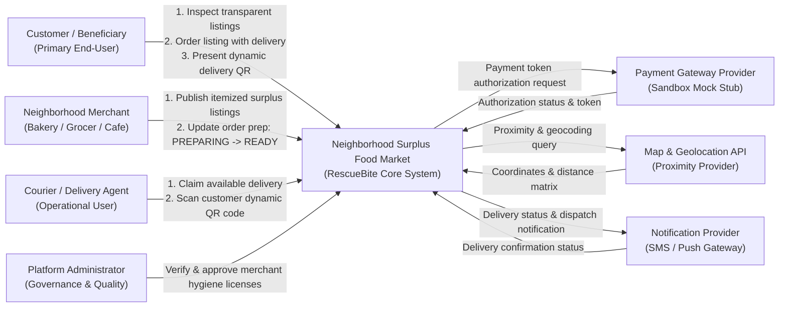
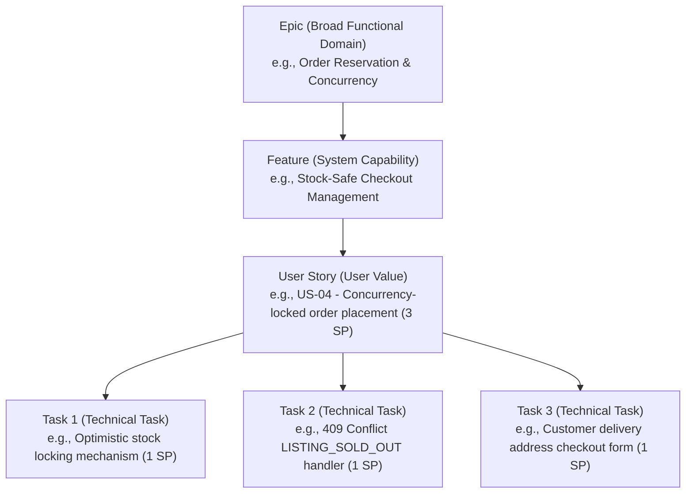

# SENG 321 Software Engineering Project
# Sprint 1 Report: Project Foundation & Team Operating Model

**Project Name:** Neighborhood Surplus Food Market (RescueBite)  
**Domain:** Transparent Food Waste Prevention & Doorstep Courier Delivery Platform  
**Team Number:** Team 13  
**Academic Term:** 2025-2026 Academic Year | Sprint 1  
**Sprint Weight:** 15% of Overall Course Grade  
**GitHub Repository:** `https://github.com/macig102/rescuebite-surplus-food-market`  
**Sprint 1 Release Tag:** `v0.1.0-sprint1`  

---

## 1. Project Proposal

### 1.1 Problem Statement and Supporting Evidence
In urban centers and local neighborhoods, commercial food businesses—including bakeries, boutique patisseries, grocery stores, cafes, and restaurants—routinely discard significant volumes of fresh, nutritious food each evening solely because it remains unsold at closing time.

* **Global Food Waste Baseline:**  
  According to the **United Nations Environment Programme (UNEP) Food Waste Index Report 2024**, over **1.05 billion tonnes** of food was wasted globally in 2022 (approx. 19% of food available to consumers). Retail establishments and food services contribute substantially to this total, accompanied by approximately 8–10% of global greenhouse gas emissions attributable to unconsumed food.
* **National Food Waste Context (Turkey):**  
  The **UNEP Food Waste Index Report (2021 & 2024)** indicates that in Turkey, household food waste reaches approximately **93 kg per capita per year**, amounting to roughly **7.7 million tonnes** annually. When combined with commercial retail, bakery, and food service losses, food disposal represents one of the largest avoidable solid waste burdens for Turkish municipalities.
* **Impact on Neighborhood Merchants:**  
  Neighborhood businesses face continuous margin erosion and inventory write-offs. Small bakeries and cafes often overproduce to avoid empty display shelves during peak afternoon hours. Operating traditional manual discount racks at closing time incurs administrative overhead, diminishes perceived brand premium, and often fails to clear remaining stock before the store shuts down.
* **Impact on Consumers in Need & The Stigma of Discount Food:**  
  Amid rising food inflation, university students, low-income households, and budget-conscious residents struggle to access wholesome, high-protein meals and fresh baked goods at affordable prices. Furthermore, physically approaching retail counters right before closing to inquire about leftover food or discounts creates significant social friction, embarrassment, and personal stigma. Existing "mystery bag" concepts also present significant anxiety for consumers with dietary restrictions, allergies, or tight budgets who cannot afford to spend money on food they cannot eat.
* **Environmental & Municipal Harm:**  
  Unsold organic matter sent to municipal landfills decays anaerobically, generating potent methane ($CH_4$) emissions, increasing landfill management costs, and squandering the water, agricultural labor, and energy embedded in food production.

### 1.2 Stakeholder Identification and Analysis

| Stakeholder | Role & Classification | System Expectations & Needs | Impact & Trust Dependency |
|---|---|---|---|
| **Customer (Beneficiary / Consumer)** | Primary End-User | Browses transparent surplus food listings nearby, reviews exact item names, quantities, and allergen information before checkout, orders with doorstep delivery, and presents a dynamic QR code for handover. | **High Impact, High Dependency:** Directly drives platform demand and social impact; relies completely on listing transparency and timely delivery. |
| **Store (Merchant: Bakery, Grocer, Cafe)** | Operational Business User | Lists surplus items with itemized contents, sets available listing bundle quantities, specifies delivery windows, prepares orders, and hands them over to couriers. | **High Impact, High Dependency:** Suppliers of surplus inventory; requires minimal operational overhead (listing creation in under 90 seconds). |
| **Platform Administrator (Admin)** | Governance & Compliance | Reviews merchant business documentation, validates food hygiene licenses (`updateStoreApproval`), monitors compliance, and audits system metrics. | **High Impact, High Dependency:** Upholds platform legality, food safety, and community trust. |
| **Courier (Delivery Agent)** | Operational Field User | Views available prepared orders (`READY_FOR_COURIER`), atomically claims delivery assignments, picks up food from merchants, navigates to customers, and scans dynamic QR codes at the doorstep. | **Medium Impact, High Dependency:** Bridges physical fulfillment between store and customer doorstep; requires fair assignment and zero double-claiming. |
| **Payment Gateway Provider** | External System Dependency (Sandbox Mock in Sprint 1) | Handles secure payment card tokenization, pre-authorization, and transaction settlement. | **High Dependency:** Order reservation is conditioned on successful payment token validation. Full banking gateway is deferred in Sprint 1 and simulated via sandbox stubs. |
| **Map & Geolocation Provider** | External System Dependency | Provides forward geocoding, store proximity queries, radius filtering, and courier travel distance calculations. | **High Dependency:** Core enabler of neighborhood discovery (`radiusKm`) and delivery dispatch. |
| **Notification Service Provider** | External System Dependency | Dispatches transaction alerts, courier status updates, and delivery confirmations via SMS/Push notifications. | **Medium Dependency:** Keeps all stakeholders informed; platform functions with in-app status polling if notifications fail. |

### 1.3 Proposed Solution and Expected Outcomes
**Neighborhood Surplus Food Market (RescueBite)** is an open-content, social-impact digital platform connecting local merchants with community consumers. Rather than discarding fresh end-of-day food or selling unpredictable "mystery boxes," merchants publish **completely transparent Surplus Food Listings**.

* **Core Business Model Principles:**
  1. **Strictly Open, Itemized Contents:** Every listing explicitly itemizes its contents (e.g., *2 Sourdough Loaves & 3 Butter Croissants*), unit portions, allergen flags, and detailed descriptions.
  2. **Zero Mystery / Surprise Policy:** Customers inspect exactly what food items and quantities they will receive before paying. No surprise bags, blind bundles, or random contents exist anywhere in the platform.
  3. **Distinct Quantity Modeling:** The system explicitly distinguishes between **available listing quantity** (e.g., 5 total bundles for sale) and **item quantity** within each bundle (e.g., 2 loaves, 3 croissants).
  4. **Substantial Price Reductions:** Surplus food is offered at 50% to 70% below regular retail prices, benefiting budget-conscious consumers while recovering food production costs for merchants.
  5. **Doorstep Courier Fulfillment:** Local couriers pick up orders from merchants and deliver directly to the customer's doorstep, eliminating customer travel and removing social stigma.
  6. **Dynamic Proof-of-Delivery QR:** Handover is authenticated using a dynamic single-use QR token displayed on the customer's phone and scanned by the courier.

* **Measurable Baseline Success Targets:**
  1. An eligible customer inspects transparent listing contents and completes an order in **less than 2 minutes**.
  2. A verified merchant publishes a transparent surplus food listing in **under 90 seconds**.
  3. The initial neighborhood pilot diverts at least **600 kg of fresh food waste** in its first operating month.
     * *Target Calculation Justification:*  
       $$\text{Rescued Weight} = 5 \text{ pilot stores} \times 4 \text{ listings/store/day} \times 1.5 \text{ kg/listing} \times 25 \text{ operating days/month} \times 80\% \text{ fulfillment rate} = 600\text{ kg}.$$
  4. Concurrent checkouts for limited listings eliminate double-booking entirely by returning **HTTP 409 Conflict (`LISTING_SOLD_OUT`)**.

### 1.4 Feasibility Assessment and Initial Scope

* **Technical Feasibility:**  
  The platform utilizes a lightweight RESTful API-first architecture defined via OpenAPI 3.1.0 specifications. External dependencies (payment processing, map geolocation, and SMS/push gateways) are modeled with modular interfaces and isolated sandbox mock providers, allowing full development within the academic semester.
* **Operational Feasibility:**  
  Merchants do not require POS modifications; they use standard listing item templates (bread, pastries, hot meal portions) and specify delivery windows. Couriers operate through lightweight web/mobile interfaces utilizing standard smartphone camera QR scanning.
* **Financial and Economic Feasibility:**  
  Development and testing utilize free academic cloud tiers, open-source tooling, and local containerized stubs. In production, transactional delivery fees and a modest merchant commission sustain operational overhead.
* **Schedule and Team Capacity:**  
  A 6-person engineering team structured across specialized BM321 roles executes the roadmap across the 14-week term, with Sprint 1 delivering the project foundation, system boundary, OpenAPI specification, and backlog.
* **First Release Scope:**
  * **In-Scope (Sprint 1 Contract & Sprints 2–3 Implementation):**
    * Platform Administrator merchant verification workflow (`updateStoreApproval`).
    * Approved merchants creating transparent Surplus Food Listings with itemized contents, allergen warnings, quantity limits, and delivery windows.
    * Customer listing discovery with geolocation proximity, category, and dietary preference filtering.
    * Concurrency-safe order placement with atomic stock reduction (**HTTP 409 Conflict** on stock depletion).
    * Store order preparation status transitions (`PLACED` $\rightarrow$ `PREPARING` $\rightarrow$ `READY_FOR_COURIER`).
    * Courier delivery pool, atomic claim (**HTTP 409 Conflict** on claim race), and doorstep dynamic QR verification.
    * Cumulative food waste rescued metrics endpoint (`GET /metrics/food-waste`) computed strictly from `DELIVERED` orders.
  * **Deferred / Out-of-Scope:**
    * Live production banking gateway integration (simulated via sandbox `paymentToken`).
    * Real-time GPS vehicle turn-by-turn routing animation (static coordinates and milestone statuses used in release 1).
    * Multi-store shopping cart consolidation (orders are placed directly per merchant listing to adhere to tight evening delivery windows).
    * Automated ERP/POS hardware synchronization.

### 1.5 Assumptions, Potential Risks, and Validation Actions

| Risk / Assumption Type | Statement & Description | Potential Impact | Mitigation Strategy & Assigned Owner |
|---|---|---|---|
| **Assumption: Merchant Participation** | Local bakeries, cafes, and grocers are willing to sell surplus stock at deep discounts rather than throwing it away. | High | Conduct discovery interviews and secure letters of intent from 5 local merchants. *(Product Owner)* |
| **Risk: Inventory Concurrency** | Two customers attempt to purchase the final remaining listing unit simultaneously. | High | Implement database-level optimistic locking with version checks; the second request receives **HTTP 409 Conflict (`LISTING_SOLD_OUT`)**. *(Lead Architect)* |
| **Risk: Courier Claim Race** | Multiple couriers attempt to claim the same prepared delivery order concurrently. | Medium | Enforce atomic state transitions; only the first claim transitions to `IN_DELIVERY`, subsequent claims receive **HTTP 409 Conflict (`DELIVERY_ALREADY_CLAIMED`)**. *(Lead Architect)* |
| **Risk: Merchant Inventory Misreporting** | A merchant enters incorrect stock quantities or runs out of items before packaging. | Medium | Provide quick store-initiated cancellation with immediate customer refund; track merchant fulfillment reliability ratings. *(QA Engineer)* |
| **Risk: Food Safety & Expiration** | Food items past safe consumption limits are listed. | Critical | Require verified hygiene certification during onboarding; restrict listings to same-day prepared items; enforce strict delivery time windows. *(Product Owner & Admin)* |
| **Risk: Allergen Mislabeling** | Listing omits common allergens (gluten, dairy, nuts), risking customer health. | Critical | Mandate structured allergen tags in `NewSurplusFoodListing` schema; display prominent allergen warnings in customer UI. *(Product Owner & Implementation Engineer)* |
| **Risk: QR Token Replay / Misuse** | Fraudulent courier or customer attempts to reuse or forge a proof-of-delivery QR token. | High | Cryptographically sign `deliveryQrToken` with single-use nonce; invalidate token immediately upon status transition to `DELIVERED`; reject expired delivery windows with **HTTP 409 Conflict**. *(Lead Architect & QA)* |
| **Risk: Personal Data Protection (KVKK / GDPR)** | Customer delivery address or contact data exposed unnecessarily. | High | Enforce role-based access control; courier only accesses address during active delivery; mask phone numbers. *(DevOps & Architect)* |
| **Risk: External Service Downtime** | Third-party map or payment APIs fail or throttle requests. | Medium | Build documented sandbox mock stubs with identical response contracts and error payloads. *(DevOps Engineer)* |

### 1.6 Open-Source License Decision Record

```markdown
Decision: Apache License 2.0

Rationale:
- Provides permissive terms allowing academic, non-commercial, and commercial evaluation and extension.
- Grants an explicit patent license from contributors to recipients, offering stronger legal security than MIT.
- Requires preservation of copyright notices, disclaimers, and clear attribution of modifications.
- Guarantees seamless compatibility with industry-standard open-source libraries and frameworks.

Follow-up Actions:
- Placed the complete Apache License 2.0 text as LICENSE in the repository root.
- Ensure copyright notices and license references are present in source code and API documentation.
- Maintain a dependency license inventory in future sprints to prevent incompatible license ingestion.
```

---

## 2. System Vision and Boundary

### 2.1 Project Purpose and Target Users (System Vision)
> **System Vision Statement:**  
> *"For neighborhood bakeries, cafes, and grocers who seek to eliminate end-of-day food waste and budget-conscious community members who need affordable, nutritious food without compromise, the **Neighborhood Surplus Food Market (RescueBite)** provides an open-content surplus catalog, concurrency-safe stock reservations, store order preparation tracking, courier dispatch, and dynamic QR doorstep proof-of-delivery. Unlike traditional food delivery networks or opaque mystery-box apps, RescueBite offers 100% transparent itemized listings, eliminates consumer purchasing anxiety, tracks verified environmental metrics, and guarantees fraud-free doorstep handovers."*

### 2.2 System Boundary and Context Diagram



### 2.3 System Responsibilities (Inside vs. Outside Boundaries)

| Inside Software Responsibility | Outside Boundary / Deferred |
|---|---|
| Transparent surplus food listing catalog with itemized food items, allergen tags, and quantities | Physical kitchen food preparation, baking, packaging, and store hygiene management |
| Real-time inventory tracking, concurrency conflict resolution, and stock locking (HTTP 409) | Core banking settlement infrastructure and merchant payout financial accounts |
| Merchant onboarding workflow and administrative approval (`isApproved: true/false`) | Physical vehicle fleet ownership, courier insurance, and road traffic routing |
| Store preparation status updates (`PLACED` $\rightarrow$ `PREPARING` $\rightarrow$ `READY_FOR_COURIER`) | Turn-by-turn map visual navigation UI (external mapping application handles navigation) |
| Dynamic single-use QR token generation and doorstep courier verification | Telecommunication carrier network delivery of SMS/push alerts |
| Courier atomic assignment locking and pool management | Merchant fiscal cash register and government tax ERP integration |
| Ecological impact tracking (cumulative kg food waste rescued from `DELIVERED` orders) | Municipal landfill physical waste auditing |

---

## 3. OpenAPI Draft Summary

The platform is architected according to strict **API-first** design principles and is formally specified in [`api/openapi.yaml`](../../api/openapi.yaml) conforming to the **OpenAPI 3.1.0** standard.

### 3.1 API Resources and HTTP Operations

| Path | HTTP Method | Operation ID | Role / Security | Description & Status Codes |
|---|---|---|---|---|
| `/listings` | `GET` | `listAvailableListings` | Public | Retrieves active surplus food listings filtered by coordinates, radius, category, and dietary preferences (`200 OK`, `400 Bad Request`). |
| `/listings` | `POST` | `createListing` | Approved Merchant (BearerAuth) | Creates a new surplus food listing with transparent items, portion quantities, allergens, and delivery hours. Returns **`403 Forbidden (STORE_NOT_APPROVED)`** if store is unverified (`201 Created`, `400`, `401`, `403`). |
| `/listings/{listingId}` | `GET` | `getListingById` | Public | Returns complete listing details, including transparent itemized contents, unit portions, allergens, and delivery window (`200 OK`, `404 Not Found`). |
| `/orders` | `POST` | `createOrder` | Customer (BearerAuth) | Places an order for a surplus food listing with doorstep delivery and payment token. **If listing stock is exhausted, returns `409 Conflict (LISTING_SOLD_OUT)`** (`201 Created`, `400`, `401`, `409`). |
| `/orders/{orderId}` | `GET` | `getOrderById` | Customer / Store (BearerAuth) | Returns order status, assigned courier, delivery milestone, and customer dynamic delivery QR token (`200 OK`, `401`, `404`). |
| `/orders/{orderId}/status` | `PATCH` | `updateOrderStatus` | Store (BearerAuth) | Allows merchant to advance order status (`PLACED` $\rightarrow$ `PREPARING` $\rightarrow$ `READY_FOR_COURIER`). Returns **`409 Conflict (INVALID_STATUS_TRANSITION)`** if transition is invalid (`200 OK`, `400`, `401`, `403`, `404`, `409`). |
| `/deliveries/available` | `GET` | `listAvailableDeliveries` | Courier (BearerAuth) | Lists orders in `READY_FOR_COURIER` status within the courier's operating vicinity awaiting pickup (`200 OK`, `401`). |
| `/deliveries/{orderId}/claim` | `POST` | `claimDelivery` | Courier (BearerAuth) | Courier claims an order. **If already claimed by another courier, returns `409 Conflict (DELIVERY_ALREADY_CLAIMED)`** (`200 OK`, `401`, `404`, `409`). |
| `/deliveries/{orderId}/verify-qr` | `POST` | `verifyDeliveryQR` | Courier (BearerAuth) | Courier submits customer's `deliveryQrToken` at doorstep. On validation, transitions to `DELIVERED`. **If token is invalid, reused, or delivery window expired, returns `409 Conflict`** (`200 OK`, `400`, `401`, `403`, `404`, `409`). |
| `/admin/stores/{storeId}/approve` | `PATCH` | `updateStoreApproval` | Platform Admin (BearerAuth) | Reviews and updates store approval status and notes (`200 OK`, `400`, `401`, `403`, `404`). |
| `/metrics/food-waste` | `GET` | `getFoodWasteMetrics` | Public | Aggregates cumulative kg of food waste rescued and CO2e emissions prevented across all orders with status `DELIVERED` (`200 OK`). |

### 3.2 Error Handling Standard (RFC 7807 / RFC 9457 `ProblemDetails`)
All API errors and domain rule conflicts return uniform problem details payloads:
```json
{
  "title": "Listing Sold Out",
  "status": 409,
  "code": "LISTING_SOLD_OUT",
  "detail": "The selected surplus food listing is sold out or the last unit was claimed by another customer."
}
```

### 3.3 Concurrency Error Catalog (HTTP 409 Conflict)
To guarantee data consistency without distributed lock bottlenecks, the API models domain race conditions explicitly:
* `LISTING_SOLD_OUT`: Two customers checkout the last remaining unit of a surplus listing simultaneously.
* `DELIVERY_ALREADY_CLAIMED`: Two couriers attempt to claim the same delivery order simultaneously.
* `INVALID_STATUS_TRANSITION`: Store attempts an out-of-order lifecycle transition (e.g., skipping `PREPARING`).
* `INVALID_QR_VERIFICATION`: The scanned QR token is corrupted, invalid, or has already been redeemed.
* `EXPIRED_DELIVERY_WINDOW`: Delivery verification is attempted after the agreed `deliveryEnd` window.

---

## 4. Team Roles and RACI Matrix

In strict compliance with the **BM321 Software Engineering Team Project Specification and Rubric**, team responsibilities and required deliverables are assigned to official rubric role titles with named student owners:

### 4.1 Team Roles and Required Outputs

| Role Title (BM321 Rubric) | Primary Responsibility | Required Outputs & Tasks | Assigned Member |
|---|---|---|---|
| **Product Owner and Requirements Engineer** | Requirements engineering and product vision | User stories, acceptance criteria, product backlog, prioritization, stakeholder validation, and food waste metric specifications. | **Zeynep Bozdemir** (230203005) |
| **Lead Software Architect and Technical Lead** | System and software architecture | System vision, context boundary diagrams, OpenAPI 3.1.0 contract design, HTTP 409 concurrency strategy, store preparation API, and code review governance. | **Mehmet Kocagöz** (220201035) |
| **Scrum Master and Agile Process Coach** | Agile process management and communication | Stand-up cadence, retrospective records, RACI matrix, impediment tracking, and GitHub Projects Kanban administration. | **Anıl Güngör** (220205003) |
| **Quality Assurance and Test Automation Engineer** | Quality assurance and test automation | Testable acceptance criteria (Given-When-Then), edge-case test definitions (409 Conflict, 403 Forbidden), dynamic QR verification testing, and quality audit sign-off. | **Tuğçe Ertem** (230201047) |
| **DevOps and CI CD Infrastructure Engineer** | Infrastructure, configuration, and deployment | Lightweight Git-Flow rulesets, branch protection policies, GitHub templates, release tagging (`v0.1.0-sprint1`), and CI/CD preparations. | **Azra Dostbil** (230204031) |
| **Implementation and Integration Engineer** | Feature implementation, cross-component integration | Feature implementation, API-UI contract alignment, listing discovery interface coordination, and technical documentation consolidation. | **Muhammed Fatih Ağaç** (230201009) |

---

### 4.2 RACI Responsibility Matrix

* **R (Responsible):** The role that conducts the hands-on work to produce the deliverable.
* **A (Accountable):** The single role with ultimate decision authority who approves the deliverable.
* **C (Consulted):** Domain contributors who provide critical inputs and feedback before completion.
* **I (Informed):** Roles kept updated on progress, decisions, and handoffs.

| Assessed Activity / Deliverable | Product Owner<br>(Zeynep Bozdemir) | Lead Architect<br>(Mehmet Kocagöz) | Scrum Master<br>(Anıl Güngör) | QA Engineer<br>(Tuğçe Ertem) | DevOps Engineer<br>(Azra Dostbil) | Implementation Eng.<br>(M. Fatih Ağaç) |
|---|:---:|:---:|:---:|:---:|:---:|:---:|
| **1. First Release Scope & Proposal Sign-off** | **A** | C | C | C | I | R |
| **2. System Vision & Context Boundary Definition** | C | **A** | I | C | I | R |
| **3. OpenAPI 3.1.0 Contract & Schema Design** | C | **A** | I | R | I | R |
| **4. Concurrency & 409 Conflict Strategy** | C | **A** | I | R | I | C |
| **5. Sprint Cadence & GitHub Operating Model** | I | C | **A** | C | R | R |
| **6. Backlog Prioritization, DoR & DoD** | **A** | C | R | R | I | R |
| **7. Acceptance Criteria (Given-When-Then)** | C | C | C | **A** | I | R |
| **8. Git-Flow Rulesets & Release Tagging** | I | C | C | C | **A** | R |
| **9. Sprint 1 Quality & Evidence Audit** | C | R | R | **A** | R | R |

---

## 5. GitHub Repository and Git-Flow Workflow

### 5.1 Branching Strategy
The team implements the standard **Lightweight Git-Flow** branch model:

```text
main
  └── Evaluated, tagged, and released versions only (e.g., v0.1.0-sprint1)
develop
  └── Integrated and tested sprint work targeted for the upcoming release
feature/<issue-id>-<short-name>
  └── Short-lived development branch linked to one user story (e.g., feature/US-02-listing-creation)
release/<version>
  └── Stabilization branch for release packaging, documentation review, and final checks
hotfix/<issue-id>-<short-name>
  └── Urgent production patch branch branched directly from main
```

### 5.2 Repository Operating Rules
1. **Issue First:** Every code, schema, or documentation change originates from a dedicated GitHub Issue with defined scope, owner, and acceptance criteria.
2. **Branch Protection:** Direct pushes to `main` and `develop` are prohibited via GitHub branch protection rules.
3. **Pull Request & Peer Review:** Every merge into `develop` requires a Pull Request matching `.github/PULL_REQUEST_TEMPLATE.md` and at least **one approving peer review** from the designated RACI lead.
4. **Traceability:** Commits and PR titles must reference the associated issue number (e.g., `feat(listings): model transparent items in surplus food listing (#3)`).
5. **Individual Accounts:** All team members commit and review from their personal GitHub accounts.
6. **Release Tagging:** Sprint milestone releases are tagged on `main` following semantic versioning (`v0.1.0-sprint1`).

---

## 6. Initial Product Backlog

The backlog strictly maintains the **Epic > Feature > Story > Task** hierarchy, establishes testable **Given-When-Then** acceptance criteria, and assigns single primary owners and story point estimates to each item.

### 6.1 Definition of Ready (DoR) and Definition of Done (DoD)
* **Definition of Ready (DoR):**
  1. **User Story Format:** Actor, capability, and tangible business/social value are explicitly articulated.
  2. **Testable Criteria:** At least two Gherkin-style (`Given - When - Then`) scenarios cover positive paths, boundary conditions, and domain error cases (409 Conflict / 403 Forbidden).
  3. **API Alignment:** Associated OpenAPI 3.1.0 operations and schemas are identified.
  4. **Right-Sized:** Sized appropriately for single-sprint completion (2–3 SP per story; 1 SP per task).
  5. **Explicit Ownership:** A single primary owner is assigned.
* **Definition of Done (DoD):**
  1. Implementation submitted via a pull request on a `feature/<issue-id>-<name>` branch.
  2. Adheres strictly to the OpenAPI 3.1.0 specification and RFC 7807/9457 problem detail error responses.
  3. Unit and contract tests pass with required assertions.
  4. Peer review approval is documented, and the branch is merged into `develop`.

---

### 6.2 Backlog Hierarchy Model (Epic > Feature > Story > Task)



---

### 6.3 Prioritized Hierarchical Product Backlog Table

| Priority | Epic ID & Name | Feature ID & Name | Story ID | User Story Statement | SP | Primary Owner | Dependencies | API Contract Impact | Acceptance Evidence Summary |
|:---:|---|---|:---:|---|:---:|---|:---:|---|---|
| **1** | **EPIC-01**<br>Merchant Governance | **FT-1.1**<br>Merchant Verification System | **US-01** | *As a platform admin, I want to inspect and approve merchant hygiene certificates, so that only verified stores can publish surplus food listings.* | **3** | Mehmet Kocagöz | None (Initial) | `PATCH /admin/stores/{id}/approve`<br>• 200 OK<br>• 403 Forbidden | Store `isApproved` becomes true; unapproved stores attempting listing creation receive 403 Forbidden (`STORE_NOT_APPROVED`). |
| **2** | **EPIC-02**<br>Surplus Food Listing Management | **FT-2.1**<br>Transparent Listing & Itemization | **US-02** | *As an approved store, I want to publish surplus listings with explicit item names, portions, allergens, and delivery windows, so that customers know exactly what they are purchasing without surprise.* | **3** | Mehmet Kocagöz | US-01 | `POST /listings`<br>`GET /listings/{id}`<br>• 201 Created<br>• 400 Bad Request<br>• 403 Forbidden | Valid listing with itemized contents published as `AVAILABLE`; expired delivery interval or missing items returns 400 Bad Request. |
| **3** | **EPIC-02**<br>Surplus Food Listing Management | **FT-2.2**<br>Listing Discovery & Multi-Filtering | **US-03** | *As a customer, I want to filter surplus listings by proximity, category, and dietary preferences, so that I can easily discover suitable food nearby.* | **3** | Muhammed Fatih Ağaç | US-02 | `GET /listings`<br>• 200 OK<br>• 400 Bad Request | Proximity, category, and dietary filters return matching active listings; empty result set returns 200 OK with empty array. |
| **4** | **EPIC-03**<br>Order Reservation & Concurrency | **FT-3.1**<br>Stock-Safe Checkout Management | **US-04** | *As a customer, I want to reserve a surplus food listing with doorstep delivery and payment token, so that my order is secured without double-booking.* | **3** | Mehmet Kocagöz | US-03 | `POST /orders`<br>• 201 Created<br>• 400 Bad Request<br>• **409 Conflict (`LISTING_SOLD_OUT`)** | Last unit purchase succeeds with 201; concurrent checkout on depleted stock returns **409 Conflict** with `LISTING_SOLD_OUT`. |
| **5** | **EPIC-03**<br>Order Reservation & Concurrency | **FT-3.2**<br>Order Lifecycle & Dynamic QR Token | **US-05** | *As a customer, I want to track my order progress and display a dynamic delivery QR token, so that I can receive my food safely at the doorstep.* | **2** | Muhammed Fatih Ağaç | US-04 | `GET /orders/{id}`<br>`PATCH /orders/{id}/status`<br>• 200 OK<br>• 404 Not Found | Order displays lifecycle milestones (`PLACED` $\rightarrow$ `PREPARING` $\rightarrow$ `READY_FOR_COURIER`) and renders dynamic `deliveryQrToken`. |
| **6** | **EPIC-04**<br>Courier Dispatch & Delivery | **FT-4.1**<br>Courier Assignment & Atomic Claim | **US-06** | *As a courier, I want to view orders ready for pickup and claim assignments atomically, so that I can deliver them without assignment conflicts.* | **3** | Mehmet Kocagöz | US-04, US-05 | `GET /deliveries/available`<br>`POST /deliveries/{id}/claim`<br>• 200 OK<br>• **409 Conflict (`DELIVERY_ALREADY_CLAIMED`)** | Order transitions from `READY_FOR_COURIER` to `IN_DELIVERY`; concurrent claim by another courier returns **409 Conflict**. |
| **7** | **EPIC-04**<br>Courier Dispatch & Delivery | **FT-4.2**<br>Doorstep Dynamic QR Proof | **US-07** | *As a courier, I want to scan the customer's QR code at their doorstep, so that I can formally verify delivery and prevent handover fraud.* | **3** | Tuğçe Ertem | US-05, US-06 | `POST /deliveries/{id}/verify-qr`<br>• 200 OK<br>• **409 Conflict (`INVALID_QR_VERIFICATION`)** | Valid token within delivery window transitions order to `DELIVERED`; expired window or reused token returns **409 Conflict**. |
| **8** | **EPIC-05**<br>Social Impact Tracking | **FT-5.1**<br>Food Waste Rescued Metrics | **US-08** | *As a customer and admin, I want to track cumulative kilograms of food rescued, so that our collective ecological contribution is verifiable.* | **2** | Zeynep Bozdemir | US-07 | `GET /metrics/food-waste`<br>• 200 OK | Aggregates `estimatedWeightKg` strictly across `DELIVERED` orders; cancelled or undelivered orders are excluded. |

---

### 6.4 Granular Developer Tasks (1 Story Point Each)

* **US-01 Tasks:**
  - `T-01.1` (Mehmet Kocagöz - 1 SP): Add `isApproved` flag to merchant entity and execute database migration.
  - `T-01.2` (Mehmet Kocagöz - 1 SP): Implement `PATCH /admin/stores/{id}/approve` endpoint with admin authorization guard.
  - `T-01.3` (Muhammed Fatih Ağaç - 1 SP): Build admin merchant verification management UI prototype.
* **US-02 Tasks:**
  - `T-02.1` (Mehmet Kocagöz - 1 SP): Implement `SurplusFoodListing` domain model with itemized contents and quantity separation.
  - `T-02.2` (Mehmet Kocagöz - 1 SP): Implement `POST /listings` and `GET /listings/{id}` with 403 unapproved store check.
  - `T-02.3` (Muhammed Fatih Ağaç - 1 SP): Create merchant listing creation form with itemized ingredient and allergen inputs.
* **US-03 Tasks:**
  - `T-03.1` (Mehmet Kocagöz - 1 SP): Implement geospatial query and dietary preference filters for `GET /listings`.
  - `T-03.2` (Muhammed Fatih Ağaç - 1 SP): Build customer discovery feed with category tabs, dietary filter chips, and map markers.
  - `T-03.3` (Tuğçe Ertem - 1 SP): Write automated tests for listing filter combinations and empty search results.
* **US-04 Tasks:**
  - `T-04.1` (Mehmet Kocagöz - 1 SP): Implement database optimistic locking on `availableListingQuantity`.
  - `T-04.2` (Mehmet Kocagöz - 1 SP): Implement `POST /orders` and wire up **`409 Conflict (LISTING_SOLD_OUT)`** handler.
  - `T-04.3` (Muhammed Fatih Ağaç - 1 SP): Build customer checkout form with delivery address fields and payment stub trigger.
* **US-05 Tasks:**
  - `T-05.1` (Mehmet Kocagöz - 1 SP): Implement single-use cryptographic `deliveryQrToken` generator and `PATCH /orders/{id}/status`.
  - `T-05.2` (Muhammed Fatih Ağaç - 1 SP): Implement client-side dynamic QR rendering and milestone progress bar on order view.
* **US-06 Tasks:**
  - `T-06.1` (Mehmet Kocagöz - 1 SP): Implement `GET /deliveries/available` query filtering orders in `READY_FOR_COURIER`.
  - `T-06.2` (Mehmet Kocagöz - 1 SP): Implement `POST /deliveries/{id}/claim` atomic assignment with **`409 Conflict`**.
  - `T-06.3` (Muhammed Fatih Ağaç - 1 SP): Build courier available delivery assignment board UI.
* **US-07 Tasks:**
  - `T-07.1` (Mehmet Kocagöz - 1 SP): Implement `POST /deliveries/{id}/verify-qr` validation logic and `DELIVERED` transition.
  - `T-07.2` (Tuğçe Ertem - 1 SP): Author automated contract tests for expired delivery window and reused token **`409 Conflict`**.
  - `T-07.3` (Muhammed Fatih Ağaç - 1 SP): Integrate mobile camera QR scanner component on courier view.
* **US-08 Tasks:**
  - `T-08.1` (Mehmet Kocagöz - 1 SP): Implement `GET /metrics/food-waste` aggregating weight exclusively from `DELIVERED` orders.
  - `T-08.2` (Muhammed Fatih Ağaç - 1 SP): Build environmental impact widget on customer profile and public landing page.

---

### 6.5 GitHub Projects Kanban Board Representation

```text
┌─────────────────────────┬─────────────────────────┬─────────────────────────┬─────────────────────────┐
│     PRODUCT BACKLOG     │       SPRINT 1 TODO     │       IN PROGRESS       │          DONE           │
├─────────────────────────┼─────────────────────────┼─────────────────────────┼─────────────────────────┤
│ [US-08] Impact Metrics  │ [US-01] Store Approval  │ [T-01.2] PATCH approve  │ [S1-DOC] Sprint 1 Report│
│ (2 SP) - Zeynep B.      │ (3 SP) - Mehmet K.      │ endpoint (Mehmet K.)    │ & RACI Matrix (Zeynep B)│
│                         │                         │                         │                         │
│ [US-07] QR Verification │ [US-02] Listing Creation│ [T-02.1] Listing model  │ [OAS-01] OpenAPI 3.1.0  │
│ (3 SP) - Tuğçe E.       │ (3 SP) - Mehmet K.      │ & items (Mehmet K.)     │ Specification (Mehmet K)│
│                         │                         │                         │                         │
│ [US-06] Courier Claim   │ [US-03] Listing Search  │ [T-04.1] Concurrency    │ [GIT-01] Git-Flow Rules │
│ (3 SP) - Mehmet K.      │ (3 SP) - M. Fatih A.    │ Stock Lock (Mehmet K.)  │ & Templates (Azra D.)   │
│                         │                         │                         │                         │
│ [US-05] Dynamic QR      │ [US-04] Stock Lock 409  │                         │                         │
│ (2 SP) - M. Fatih A.    │ (3 SP) - Mehmet K.      │                         │                         │
└─────────────────────────┴─────────────────────────┴─────────────────────────┴─────────────────────────┘
```

---

### 6.6 Testable Acceptance Criteria (Given / When / Then)

#### US-01: Platform Admin Store Approval
```gherkin
Scenario 1: Successful store approval
  Given a registered merchant "Kadikoy Artisan Bakery" with valid hygiene credentials,
  When the administrator sends PATCH /admin/stores/STR-34-KADIKOY/approve with isApproved=true,
  Then the system returns HTTP 200 OK and the store status transitions to approved (isApproved=true).

Scenario 2: Unapproved store rejected from listing surplus food
  Given a store whose registration is unverified (isApproved=false),
  When the store attempts to create a surplus food listing via POST /listings,
  Then the system returns HTTP 403 Forbidden with problem code "STORE_NOT_APPROVED".
```

#### US-02: Surplus Food Listing Creation & Itemization
```gherkin
Scenario 1: Valid transparent listing created by approved store
  Given an approved merchant is authenticated via BearerAuth,
  When they post a listing with initialListingQuantity=5, delivery window (19:30 - 21:30), and items list containing [2 Artisan Sourdough Breads, 3 Butter Croissants] with declared allergens,
  Then the system returns HTTP 201 Created with status "AVAILABLE" and the itemized food list is persisted.

Scenario 2: Listing rejected when delivery end time is in the past
  Given an approved merchant submits the listing creation form,
  When the deliveryEnd timestamp is earlier than deliveryStart or in the past,
  Then the system returns HTTP 400 Bad Request with problem code "INVALID_PICKUP_INTERVAL".

Scenario 3: Listing rejected without itemized food contents
  Given an approved merchant attempts to create a listing,
  When the items array is empty or missing,
  Then the system returns HTTP 400 Bad Request with validation details requiring at least one food item.
```

#### US-03: Surplus Food Listing Discovery & Multi-Filtering
```gherkin
Scenario 1: Successful proximity and dietary preference filtering
  Given active surplus food listings exist within Kadikoy,
  When a customer sends GET /listings?latitude=40.9856&longitude=29.0289&radiusKm=3&dietaryPreference=VEGETARIAN,
  Then the system returns HTTP 200 OK containing only vegetarian listings within a 3 km radius, with each listing displaying its transparent itemized contents.

Scenario 2: Search returns empty list when no listings match criteria
  Given no active listings exist within a 1 km radius for category "MEALS",
  When a customer sends GET /listings with radiusKm=1 and category=MEALS,
  Then the system returns HTTP 200 OK with an empty array [].
```

#### US-04: Concurrent Checkout Stock Conflict (HTTP 409)
```gherkin
Scenario 1: Successful checkout of final remaining listing unit
  Given only 1 unit remains in stock (availableListingQuantity=1) for listing "LST-2026-0042",
  When Customer A submits POST /orders with valid payment token and delivery address,
  Then the system returns HTTP 201 Created, generates order ORD-2026-9812, and sets listing stock to 0 (SOLD_OUT).

Scenario 2: Concurrent checkout conflict rejected with 409
  Given the stock depleted to 0 due to Customer A's checkout,
  When Customer B concurrently submits POST /orders for the same listing,
  Then the system returns HTTP 409 Conflict with RFC 7807 problem code "LISTING_SOLD_OUT".
```

#### US-05: Order Progress Tracking & Dynamic Delivery QR Token
```gherkin
Scenario 1: Customer views order lifecycle and dynamic delivery QR token
  Given Customer A has placed order "ORD-2026-9812",
  When the customer requests GET /orders/ORD-2026-9812,
  Then the system returns HTTP 200 OK displaying status "PLACED", listing items, and a single-use dynamic "deliveryQrToken".

Scenario 2: Merchant advances preparation status
  Given order "ORD-2026-9812" is in status "PLACED",
  When the merchant sends PATCH /orders/ORD-2026-9812/status with status="PREPARING",
  Then the system returns HTTP 200 OK and updates the order status to "PREPARING".
```

#### US-06: Concurrent Courier Assignment Conflict (HTTP 409)
```gherkin
Scenario 1: First courier claims ready delivery order
  Given an order is in status "READY_FOR_COURIER" in the courier delivery pool,
  When Courier 1 submits POST /deliveries/ORD-2026-9812/claim,
  Then the system returns HTTP 200 OK, assigns courierId="CR-18", and transitions status to "IN_DELIVERY".

Scenario 2: Second courier receives 409 Conflict on already claimed order
  Given the order was claimed by Courier 1 moments earlier,
  When Courier 2 concurrently submits POST /deliveries/ORD-2026-9812/claim,
  Then the system returns HTTP 409 Conflict with problem code "DELIVERY_ALREADY_CLAIMED".
```

#### US-07: Doorstep Dynamic QR Proof-of-Delivery Verification
```gherkin
Scenario 1: Valid QR code verification completes delivery
  Given order "ORD-2026-9812" is in status "IN_DELIVERY" within the active delivery window,
  When the assigned courier submits customer's deliveryQrToken via POST /deliveries/ORD-2026-9812/verify-qr,
  Then the system returns HTTP 200 OK, transitions order status to "DELIVERED", records deliveredAt timestamp, and permanently invalidates the token.

Scenario 2: Verification rejected outside delivery time window
  Given the scheduled delivery time window has passed (current time > deliveryEnd),
  When the courier attempts to verify handover via POST /deliveries/ORD-2026-9812/verify-qr,
  Then the system returns HTTP 409 Conflict with problem code "EXPIRED_DELIVERY_WINDOW".

Scenario 3: Replay attempt with already used QR token rejected
  Given order "ORD-2026-9812" has already transitioned to "DELIVERED",
  When any courier submits the same deliveryQrToken again,
  Then the system returns HTTP 409 Conflict with problem code "INVALID_QR_VERIFICATION".
```

#### US-08: Cumulative Food Waste Rescued Metrics
```gherkin
Scenario 1: Query cumulative food waste rescued metrics
  Given multiple orders have been fulfilled across the platform,
  When a user or admin requests GET /metrics/food-waste,
  Then the system returns HTTP 200 OK with totalRescuedWeightKg, totalDeliveredOrders, and co2EmissionsPreventedKg calculated strictly from orders with status "DELIVERED".

Scenario 2: Cancelled or in-transit orders excluded from rescued food metrics
  Given order ORD-1 is "DELIVERED" (1.5 kg) and order ORD-2 is "CANCELLED" (2.0 kg),
  When the metrics calculation executes,
  Then totalRescuedWeightKg reflects only 1.5 kg and completely excludes the cancelled 2.0 kg.
```

---

## 7. Sprint 1 Submission Checklist

- [x] **Scope Consistency:** The proposal, system vision, boundary context diagram, OpenAPI contract, and product backlog describe the exact same first release capabilities without scope discrepancies.
- [x] **Strictly Transparent Business Model:** Every mention of mystery bags or surprise packages has been purged. Listings explicitly itemize food contents, quantities, allergens, and discounted prices.
- [x] **Valid OpenAPI 3.1.0 Contract:** `api/openapi.yaml` validates against OpenAPI 3.1.0 specifications and includes complete schemas, RFC 7807/9457 Problem Details, store preparation endpoints, and HTTP 409 Conflict concurrency handling.
- [x] **Visible & Named Ownership:** Team members are mapped to official BM321 rubric role titles with named accountability in the RACI matrix and backlog.
- [x] **Enforced Repository Workflow:** Lightweight Git-Flow branching, pull request templates, and branch protection policies comply with course requirements.
- [x] **Granular Backlog & Testable Criteria:** All user stories adhere to DoR and DoD, avoid giant stories via 1 SP technical tasks, and include testable Given-When-Then scenarios covering positive paths and edge cases.
